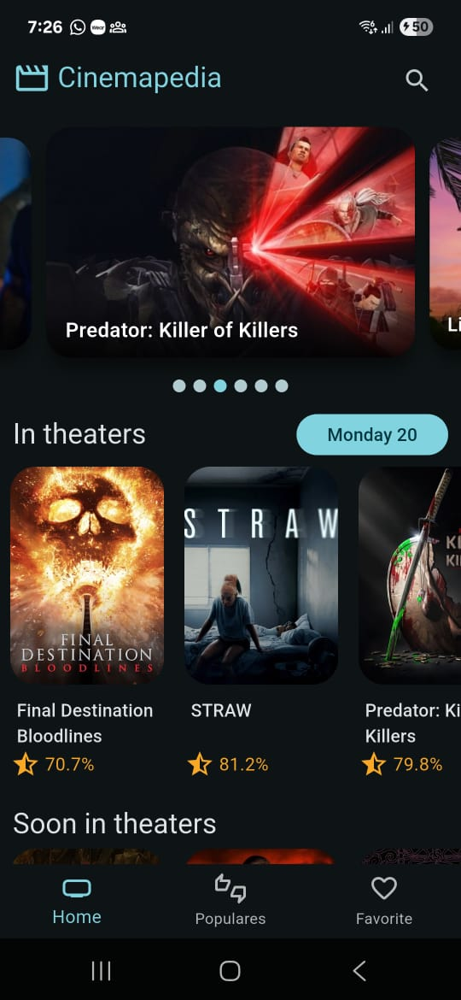

# 🎬 Cinemapedia - Movie Discovery App

Welcome to Cinemapedia, a Flutter-based movie discovery application that allows you to explore movies currently in theaters, upcoming releases, top-rated films, and popular titles. The app features a rich movie detail screen with comprehensive information and uses local storage for favorites.

## Features

- **Movie Categories**: Browse movies in theaters, upcoming releases, top-rated, and popular films.
- **Search Functionality**: Find movies quickly with the search delegate.
- **Favorites System**: Save your favorite movies locally using Isar database.
- **Detailed Movie View**: 
  - Overview, genres, and release date
  - Cast information
  - Trailers and videos
  - Similar movie recommendations
- **Beautiful UI**: 
  - Masonry layout for popular and favorite movies
  - Animations and transitions
  - Slivers for smooth scrolling
  - AutomaticKeepAliveClientMixin for state preservation

## Screenshots

 


## Requirements

- Flutter SDK (version 3.0.0 or higher)
- Dart (version 2.17.0 or higher)
- The [MovieDB](https://www.themoviedb.org/) API key

## Installation

1. **Clone the repository**:
   ```bash
   git clone https://github.com/lauritaila/cinemapedia.git
2. **Navigate to the project directory**:
   ```bash
   cd cinemapedia
3. **Download and add videos**:
    - Copy .env.template and rename it to .env
    - Update with your The MovieDB API credentials
4. **Generate necessary files**:
   ```bash
   flutter pub run build_runner build
5. **Install dependencies**:
   ```bash
   flutter pub get
6. **Run the app**:
   ```bash
   flutter run

## Customization for production🎨

You can easily customize key parts of the application using the following commands:

1. **Change Splash Screen**: To update the native splash screen that appears when the app starts.
   ```bash
   dart run flutter_native_splash:create
5. **Change Launcher Icon**: To generate new app icons for different platforms.
   ```bash
   dart run flutter_launcher_icons:generate
6. **Change Bundle ID / Package Name**: To update the application's unique identifier.
   ```bash
   dart run change_app_package_name:main com.new.package.name
## Project Structure (Clean Architecture Inspired)

The app follows a basic structure inspired by Clean Architecture, separating concerns into layers:

```
cinemapedia/
├── lib/
│   ├── main.dart               # Application entry point
│   ├── config/                 # Configuration files
│   │   ├── router/            # App routing configuration
│   │   └── theme/             # App theme customization
│   ├── domain/                 # Business logic layer
│   │   ├── entities/           # Core business entities
│   │   └── repositories/       # Repository interfaces
│   ├── infrastructure/         # Data layer implementation
│   │   ├── datasources/        # Remote and local data sources
│   │   ├── models/             # Data transfer objects
│   │   └── repositories/       # Repository implementations
│   └── presentation/           # UI layer
│       ├── providers/          # State management (Riverpod)
│       ├── screens/            # App screens
│       ├── widgets/            # Reusable UI components
│       └── delegates/          # Custom search delegate
├── test/                       # Test files
└── pubspec.yaml                # Project dependencies
```

### How the Layers Work Together:

1. **`Domain Layer`**: 
    - Contains business logic and entities
    - Defines repository contracts
2. **`Infrastructure Layer`**: 
    - Implements remote (The MovieDB API) and local (Isar) data sources
    - Handles data model conversions
    - Provides repository implementations
3. **`Presentation Layer`**: 
    - Manages UI components and state
    - Uses Riverpod for state management
    - Implements custom widgets and animations

---

This structure ensures a clean separation of concerns, making the app easier to maintain, test, and scale.

## Dependencies

- **UI & Animation**:
    - [animate_do](https://pub.dev/packages/animate_do): Adds animations to the UI.
    - [card_swiper](https://pub.dev/packages/card_swiper): For movie carousels.
    - [flutter_staggered_grid_view](https://pub.dev/packages/flutter_staggered_grid_view): Masonry layout.
- **State Management & Routing**:
    - [flutter_riverpod](https://pub.dev/packages/flutter_riverpod): State management.
    - [go_router](https://pub.dev/packages/go_router): Navigation routing.
- **Data**:
    - [flutter_riverpod](https://pub.dev/packages/dio): HTTP client.
    - [flutter_dotenv](https://pub.dev/packages/flutter_dotenv): Environment variables.
    - [isar](https://pub.dev/packages/isar): Local database.
    - [isar_flutter_libs](https://pub.dev/packages/isar_flutter_libs): Isar Flutter support.
    - [path_provider](https://pub.dev/packages/path_provider): Filesystem paths.
- **Features**:
    - [intl](https://pub.dev/packages/intl ): Provides internationalization and localization utilities.
    - [youtube_player_flutter](https://pub.dev/packages/youtube_player_flutter ): Video playback.
-  **Production**:
    - [flutter_native_splash](https://pub.dev/packages/flutter_native_splash): Native splash screen.
    - [flutter_launcher_icons](https://pub.dev/packages/flutter_launcher_icons): App icons.
    - [change_app_package_name](https://pub.dev/packages/change_app_package_name): Package name.

## Production Build for Android

All the documentation to deploy the app in production for Android is in the [Flutter Docs - Build and release an Android app](https://docs.flutter.dev/deployment/android).

To build the app for Android, run the following command:
```bash
flutter build appbundle
```

## Contributing
Contributions are welcome! If you have any ideas to improve the app, please open an issue or submit a pull request.